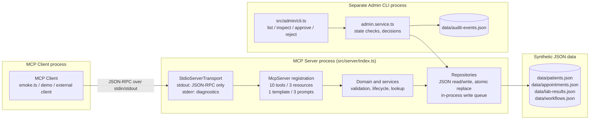

# Integration Assistant — MCP-Based Healthcare Workflow Simulator

A local, synthetic healthcare integration workflow simulator built with the official
[Model Context Protocol (MCP)](https://modelcontextprotocol.io/) SDK. It exposes a real
MCP server over stdio with **10 tools**, **3 read-only resources**, **1 patient resource
template**, and **3 prompts**, plus a **separate human Admin CLI** for approval and
rejection decisions.

**This project is an educational prototype, not a production healthcare system.** Every
patient, appointment, laboratory-style result, workflow, and integration system is
fictional. It does not connect to real hospitals, hospital information systems, or
external healthcare APIs; it does not access real patient records; it does not execute
healthcare workflows; and it does not publish integrations. `APPROVED` is only a recorded
human decision — nothing is ever run or deployed.

See [data/README.md](data/README.md) for details on the synthetic dataset.

---

## Table of contents

- [What problem this demonstrates](#what-problem-this-demonstrates)
- [Key features](#key-features)
- [Technology stack and requirements](#technology-stack-and-requirements)
- [Architecture overview](#architecture-overview)
- [MCP implementation](#mcp-implementation)
- [Synthetic healthcare data](#synthetic-healthcare-data)
- [Workflow lifecycle and business logic](#workflow-lifecycle-and-business-logic)
- [Human-in-the-loop approval and Admin CLI](#human-in-the-loop-approval-and-admin-cli)
- [Audit events](#audit-events)
- [Installation and setup](#installation-and-setup)
- [Running the project](#running-the-project)
- [MCP client configuration](#mcp-client-configuration)
- [Complete end-to-end example](#complete-end-to-end-example)
- [Testing and quality assurance](#testing-and-quality-assurance)
- [Project structure](#project-structure)
- [Security, privacy, and limitations](#security-privacy-and-limitations)
- [Design decisions and future improvements](#design-decisions-and-future-improvements)
- [License and contribution](#license-and-contribution)

---

## What problem this demonstrates

Healthcare integration work usually involves moving information between systems such as
electronic health records, scheduling tools, laboratories, and referral systems. In a real
environment that work is tightly regulated, uses sensitive data, and requires human
oversight before changes are accepted.

This simulator models that shape of problem safely:

- An AI assistant (an **MCP client**) can inspect fictional patients, appointments, lab
  results, and workflows through a controlled set of read-only and lifecycle tools.
- The assistant can assemble a workflow draft from real synthetic records, validate it,
  and submit it for **human review**.
- The assistant deliberately **cannot** approve, reject, execute, or publish anything.
  Those decisions belong to a separate human process (the Admin CLI).
- A small, explicit state machine and audit event log make the lifecycle observable.

MCP is used because it provides a standard, transport-friendly way for an AI client to
discover tools, resources, and prompts from a server. Here the transport is stdio: the
client spawns the server as a child process and speaks JSON-RPC over its standard input
and output. That makes the integration realistic without needing a network service,
database, or cloud account.

---

## Key features

- **Real MCP communication** — a real client connects to a real server process over
  stdio using the official SDK; no in-process shortcuts.
- **Synthetic healthcare data** — fictional patients, appointments, lab-style results,
  and workflows stored as JSON files.
- **Read-only data retrieval** — tools for patients, appointments, lab results, and
  workflows; resource reads never modify data.
- **Workflow lifecycle** — create drafts, validate them read-only, submit valid drafts
  for approval, and revise rejected workflows back to `DRAFT`.
- **Separate human Admin CLI** — `list`, `inspect`, `approve`, and `reject` run in a
  different process and are never registered as MCP tools.
- **Audit events** — approvals and rejections are recorded in a separate event file.
- **MCP Resources** — three static context documents and a `patient://{id}` resource
  template backed by real synthetic patient data.
- **MCP Prompts** — reusable instruction templates for workflow creation, patient
  summarization, and draft review.
- **Automated tests** — 94 tests across 7 files, including real stdio integration tests.
- **Reproducible demonstration** — `npm run demo` drives the whole flow against an
  isolated temporary data directory.

---

## Technology stack and requirements

All versions below are pinned in [package.json](package.json) and
[package-lock.json](package-lock.json).

| Technology | Version | Role |
| --- | --- | --- |
| Node.js | `>=18` runtime requirement | Hosts both the server and client processes; verified on Node 26 |
| npm | bundled with Node | Installs local dependencies and runs the npm scripts |
| TypeScript | `5.9.3` | Strictly typed source (`strict: true`, `noUnusedLocals`, `noUnusedParameters`) |
| `@modelcontextprotocol/sdk` | `1.32.2` | Official MCP SDK: `McpServer`, `StdioServerTransport`, `ResourceTemplate`, client APIs |
| Zod | `4.6.7` | Runtime validation of tool and prompt arguments |
| Vitest | `5.1.1` | Test runner (dev dependency) |
| tsx | `4.23.15` | Runs TypeScript directly during development/tests (dev dependency) |
| `@types/node` | `26.6.6` | Node type definitions (dev dependency) |

The project uses ESM (`"type": "module"`), `NodeNext` module resolution, and an ES2022
target. See [tsconfig.json](tsconfig.json) and [tsconfig.build.json](tsconfig.build.json).

**Development environment:** Node.js 18 or newer, npm, and a POSIX-like shell for the
documented commands. The code itself uses only Node built-ins plus the dependencies
above, so it is platform-independent; the shell examples assume `bash`/`zsh`. No global
packages are required. Write access to a temporary directory is needed by the tests and
demo, which copy fixtures into isolated directories.

---

## Architecture overview



**Responsibilities**

| Component | Responsibility |
| --- | --- |
| MCP Client | Discovers capabilities, calls tools, reads resources, requests prompts |
| MCP Server ([index.ts](src/server/index.ts)) | Creates `McpServer`, registers tools/resources/prompts, connects stdio transport, handles shutdown |
| Tool modules ([src/server/tools/](src/server/tools/)) | Input schemas, descriptions, and conversion of service results into MCP `CallToolResult` |
| Resources ([resources.ts](src/server/resources.ts)) | Static context documents and the read-only patient resource template |
| Prompts ([prompts.ts](src/server/prompts.ts)) | Instruction templates returned to the client; no execution |
| Services ([src/services/](src/services/)) | Validation, workflow lifecycle, lookups, admin decisions |
| Repositories ([src/repositories/](src/repositories/)) | JSON file access, atomic writes, in-process serialization, audit event storage |
| Admin CLI ([cli.ts](src/admin/cli.ts)) | Human approval/rejection in a separate process |

**Why is the Admin CLI separate?** Approval and rejection are trust decisions. Keeping
them out of the MCP server means an AI client has no path — no tool, resource, or prompt
— that can approve or reject a workflow. The MCP server never imports the admin service
or the audit repository; the CLI is the only caller. This boundary is intentional and is
enforced by the code structure and by tests that check the live tool inventory.

**Persistence:** all state lives in JSON files. The default directory is resolved
relative to the repository module (so it works from `src/` and compiled `dist/`); setting
`MCP_DATA_DIR` overrides it. Writes go to a temporary file and are renamed into place.
See [json-store.ts](src/repositories/json-store.ts).

---

## MCP implementation

MCP is a protocol that lets a client discover and use capabilities exposed by a server.
In this project:

- The **server** ([index.ts](src/server/index.ts)) constructs an `McpServer`, registers
  capabilities, and attaches a `StdioServerTransport`.
- The **client** (for example [smoke.ts](src/client/smoke.ts) or
  [end-to-end-demo.ts](scripts/end-to-end-demo.ts)) spawns the server with
  `process.execPath`, performs the MCP `initialize` handshake, and closes it when done.
- **stdio transport** means request/response JSON-RPC messages travel over the child
  process's stdin/stdout. Therefore **stdout is reserved exclusively for the protocol**:
  server-side code contains no `console.log` or `stdout.write`. Diagnostics use
  `console.error`, which writes to stderr. Tests verify the server runs as a distinct
  child process and that the compiled `dist/server/index.js` works from any working
  directory.

### MCP Tools

Exactly 10 tools are registered. Inputs are validated with Zod at runtime. Successful
results use a `{ "notice": "...", "data": ... }` JSON text envelope; failures use MCP
`isError: true` with a readable message, never a stack trace or local path.

| # | Tool | Purpose | Input parameters | Important behavior |
| --- | --- | --- | --- | --- |
| 1 | `get_patient` | Retrieve one synthetic patient | `patient_id` (required, non-empty string) | Returns id, display name, date of birth, status, creation time. Unknown ID → not-found error. Does not include appointments or labs. |
| 2 | `get_patient_summary` | Retrieve a patient with related records | `patient_id` (required) | Returns the patient, their appointments and lab results, an explicit `missing_information` list, and a data notice. Unknown ID → error. No clinical inference. |
| 3 | `list_appointments` | List synthetic appointments | `patient_id` (optional), `status` (optional: `scheduled`, `completed`, `cancelled`) | Filters by patient and/or status; returns an array, empty when nothing matches. Never modifies appointments. |
| 4 | `get_lab_results` | List lab-style results for one patient | `patient_id` (required) | Unknown patient → error; existing patient with no results → empty array. Values are illustrative, not diagnoses. |
| 5 | `get_workflow` | Inspect one workflow | `workflow_id` (required) | Returns status, steps, references, `last_validation`, and history. Unknown ID → error. Read-only. |
| 6 | `list_workflows` | List workflows, optionally filtered | `status` (optional: `DRAFT`, `PENDING_APPROVAL`, `APPROVED`, `REJECTED`) | Returns an array, empty when nothing matches. Read-only. |
| 7 | `create_workflow_draft` | Create a new draft | Required: `name`, `patient_id`, `source_system`, `destination_system`, `template`, `steps`. Optional: `appointment_ids`, `lab_result_ids`, `description` | Validates patient, systems, template, unique non-empty steps, and every referenced record (including patient ownership) before saving. Creates `DRAFT` with a generated `WF-SYN-NNN` id. Never submits or executes. |
| 8 | `validate_workflow` | Read-only workflow validation | `workflow_id` (required) | Returns `{ valid, errors, warnings, workflow_id }`. Separates blocking errors from warnings. Writes nothing; does not change status, timestamps, or stored validation. |
| 9 | `submit_workflow_for_approval` | Submit a draft for human review | `workflow_id` (required) | `DRAFT` only. Reloads the latest persisted record and revalidates it; invalid drafts remain `DRAFT` with errors returned. Valid drafts become `PENDING_APPROVAL` with a history entry. Never approves, executes, or publishes. |
| 10 | `revise_workflow_draft` | Revise a rejected workflow | `workflow_id` (required) plus the full editable fields (`name`, `patient_id`, `source_system`, `destination_system`, `template`, `steps`; optional `appointment_ids`, `lab_result_ids`, `description`, `revision_note`) | `REJECTED` only. Preserves id and creation time, updates modification time, clears stale validation, keeps rejection context in history, validates new content, and returns `DRAFT` **without** submitting. |

Supported synthetic systems: `EHR_SYNTH`, `LAB_SYNTH`, `SCHEDULER_SYNTH`,
`REFERRAL_SYNTH`. Supported templates: `INTAKE_HANDOFF`, `LAB_REVIEW`,
`REFERRAL_COORDINATION`.

**Approval and rejection are not MCP tools.** There is no `approve_workflow`,
`reject_workflow`, `list_patients`, `publish_workflow`, or `execute_workflow` tool.

### MCP Resources

Resources are read-only, URI-addressable context. Reading one never writes a JSON file
or changes workflow state.

| URI | Kind | Content |
| --- | --- | --- |
| `integration://systems` | Static | Simulated data domains, the four fictional integration systems, simulator capabilities, and explicit statements that no real hospital or external API is connected |
| `workflow://templates` | Static | The three implemented templates with source/destination systems, steps, and a machine-readable catalog |
| `workflow://states` | Static | The actual state machine, transition ownership, validation rules, and the fact that `APPROVED` does not mean executed or published |
| `patient://{id}` | Resource template | One synthetic patient by ID, retrieved through the existing patient service; unknown IDs return a resource error |

Static resources are registered at fixed URIs. The patient resource is a
`ResourceTemplate`: its URI pattern is `patient://{id}`, its discovery callback lists
only real patient IDs from the synthetic dataset, and a read callback fills in `{id}`
through `getPatient`. All resources return Markdown with a machine-readable JSON section.

```ts
// Example client-side usage
const { resources } = await client.listResources();
const { resourceTemplates } = await client.listResourceTemplates();
const patient = await client.readResource({ uri: "patient://PAT-SYN-001" });
```

### MCP Prompts

Prompts return instruction messages to the connected AI client. They are **advisory
text**: they do not call tools, modify data, or enforce the behavior of an AI model.

| Prompt | Arguments | Purpose |
| --- | --- | --- |
| `create_patient_integration_workflow` | `patient_id` (required) | Retrieve patient → appointments/labs → templates, create a draft, validate it; submit immediately on success and stop, or leave it in `DRAFT` on failure and stop. Never approve, execute, or publish. |
| `summarize_patient_information` | `patient_id` (required) | Summarize only real synthetic tool data, distinguish missing information from negative findings, invent nothing clinical, and label everything as fictional. |
| `review_workflow_draft` | `workflow_id` (required) | Retrieve workflow, status, validation, templates, and patient context; report errors and warnings separately; never modify, approve, execute, or publish. Human decisions happen in the Admin CLI. |

Arguments are required and validated; missing or invalid arguments produce an MCP error.
The creation prompt deliberately has **no extra user-confirmation gate** before
`submit_workflow_for_approval`: after successful validation the sequence is
`create_workflow_draft → validate_workflow → submit_workflow_for_approval → stop`.

---

## Synthetic healthcare data

The committed dataset in [data/](data/) is entirely fictional:

| File | Contents |
| --- | --- |
| [patients.json](data/patients.json) | 3 synthetic patients, ids `PAT-SYN-001` … `PAT-SYN-003` |
| [appointments.json](data/appointments.json) | 5 appointments, `APT-SYN-001` … `APT-SYN-005`, each with a `patient_id` |
| [lab-results.json](data/lab-results.json) | 5 lab-style results, `LAB-SYN-001` … `LAB-SYN-005`, each with a `patient_id` |
| [workflows.json](data/workflows.json) | 4 workflows, `WF-SYN-001` … `WF-SYN-004`, referencing patients and related records |

A representative patient record:

```json
{
  "id": "PAT-SYN-001",
  "display_name": "Avery Cedarwood",
  "date_of_birth": "1988-04-12",
  "status": "active",
  "created_at": "2026-09-01T08:00:00Z"
}
```

Appointments and lab results link to patients through `patient_id`; workflows link through
`patient_id` plus arrays of `appointment_ids` and `lab_result_ids`. The initial fixtures
are `WF-SYN-001` (`DRAFT`), `WF-SYN-002` (`PENDING_APPROVAL`), `WF-SYN-003` (`DRAFT`),
and `WF-SYN-004` (`REJECTED`, with a synthetic rejection note). There is no `APPROVED`
fixture.

Repositories read arrays from JSON files and filter in memory. Writes use a temporary
file plus atomic rename, and workflow read-modify-write operations are serialized by an
in-process promise queue ([workflow.repository.ts](src/repositories/workflow.repository.ts)).
Validation checks referential integrity — every referenced patient, appointment, and lab
result must exist, and related records must belong to the workflow's patient. Repository
tests verify those relationships and that filters never mutate the source files.

> **Warning:** do not replace these files with real patient data. The safety of this
> project depends on all records being fictional. Lab values and reference ranges are
> illustrative demonstration values, not clinical results or medical advice.

---

## Workflow lifecycle and business logic

The state machine is deliberately small and explicit:

```text
DRAFT
  |
  | validate successfully and submit
  v
PENDING_APPROVAL
  |
  +--------------------+
  |                    |
  | approve             | reject
  v                    v
APPROVED             REJECTED
                       |
                       | revise
                       v
                     DRAFT
```

| State | Meaning |
| --- | --- |
| `DRAFT` | Initial state for new workflows. Can be validated, submitted, or revised back to after rejection. Cannot be approved or rejected by the CLI. |
| `PENDING_APPROVAL` | Submitted for human review. MCP tools are read-only here; only the Admin CLI can decide. |
| `APPROVED` | A human approved the draft. This is a state value only — no execution or publishing occurs. |
| `REJECTED` | A human rejected the draft with a reason. Only this state can be revised. |

### Transition responsibilities

| Transition | Responsible component | Tool / command |
| --- | --- | --- |
| — → `DRAFT` | MCP Server | `create_workflow_draft` |
| `DRAFT` → `PENDING_APPROVAL` | MCP Server | `submit_workflow_for_approval` |
| `PENDING_APPROVAL` → `APPROVED` | Admin CLI | `npm run admin -- approve ...` |
| `PENDING_APPROVAL` → `REJECTED` | Admin CLI | `npm run admin -- reject ...` |
| `REJECTED` → `DRAFT` | MCP Server | `revise_workflow_draft` |

All other transitions are rejected with a clear error. There is no `VALIDATING` state,
no transition out of `APPROVED`, and no automatic execution step.

### Important semantics

- **Validation is read-only.** `validate_workflow` returns `{ valid, errors, warnings,
  workflow_id }` and writes nothing — no status change, no timestamp change, no stored
  validation result.
- **Submission revalidates.** `submit_workflow_for_approval` reloads the latest persisted
  record and validates it from scratch, so a draft whose references became invalid after
  an earlier validation cannot be submitted.
- **Invalid drafts stay `DRAFT`.** Submission errors are returned without changing state.
- **Successful submission sets `PENDING_APPROVAL`**, updates the timestamp, stores the
  validation result in `last_validation`, and appends a history entry.
- **Revision is `REJECTED` → `DRAFT` only.** It preserves the workflow id and creation
  timestamp, updates the modification timestamp, clears stale validation information,
  retains the rejection note and history, validates the new content, and **does not
  submit automatically**. A revised workflow must be explicitly validated and submitted
  again as separate operations.

---

## Human-in-the-loop approval and Admin CLI

Human approval exists to keep consequential decisions out of automated tool calls. The
MCP server can prepare and submit work, but a person must decide whether a pending
workflow is acceptable.

The Admin CLI is a separate process ([cli.ts](src/admin/cli.ts)) using Node's built-in
`node:util` `parseArgs` — no CLI framework dependency. It reuses domain types,
repositories, and persistence, but is never imported or registered by the MCP server.

```bash
npm run admin -- list
npm run admin -- inspect WF-SYN-002
npm run admin -- approve WF-SYN-002 --actor "admin@example.com"
npm run admin -- reject WF-SYN-002 --actor "admin@example.com" --reason "Missing integration details"
```

| Command | Behavior |
| --- | --- |
| `list` | Prints workflows in `PENDING_APPROVAL` with status and basic details |
| `inspect <id>` | Prints fields, status, validation metadata, history, and audit events |
| `approve <id> --actor <label>` | Transitions `PENDING_APPROVAL` → `APPROVED` only |
| `reject <id> --actor <label> --reason <text>` | Transitions `PENDING_APPROVAL` → `REJECTED` only; requires a non-empty reason |

Both decisions require a non-empty `--actor`. Invalid commands, missing IDs, empty
arguments, and invalid transitions print a readable error and exit non-zero.

**`--actor` is a self-declared audit label — not authentication or authorization.**
Anyone who can run the CLI can supply any label. There is no identity verification,
role check, signature, or multi-user access control. CLI output always states that the
decision does not execute or publish the workflow.

---

## Audit events

Each successful Admin CLI approval or rejection produces one event in
`data/audit-events.json` (or under `MCP_DATA_DIR`). The file is separate from the
workflow fixtures and ignored by Git ([.gitignore](.gitignore)).

An event contains:

| Field | Description |
| --- | --- |
| `workflow_id` | The affected workflow |
| `action` | `APPROVED` or `REJECTED` |
| `actor` | The self-declared `--actor` label |
| `timestamp` | ISO 8601 timestamp |
| `reason` | Present only for rejections |

The repository ([audit.repository.ts](src/repositories/audit.repository.ts)) reads all
existing events, appends the new one, and atomically rewrites the JSON file. Inspecting a
workflow with the CLI shows its recorded events.

**Limitations — be precise:** this is an *append-style* log implemented by read-all plus
atomic rewrite, **not** strict append-only storage. There is no cryptographic hash chain,
no tamper-detection guarantee, no cross-process file locking, and no durability guarantee
beyond a local JSON file write. A crash between the workflow write and the audit write can
leave the two inconsistent. Atomic rename alone does not guarantee full crash durability.

---

## Installation and setup

```bash
git clone https://github.com/moein-71/Integration-Assistant-MCP-Based-Healthcare-Workflow-Simulator.git
cd Integration-Assistant-MCP-Based-Healthcare-Workflow-Simulator

node --version   # must be >= 18
npm --version

npm install
npm run typecheck
npm run build
npm test
```

All scripts come from [package.json](package.json): `build`, `typecheck`, `test`, `smoke`,
`server`, `admin`, and `demo`.

**Environment variables:** the source uses one — `MCP_DATA_DIR`. When set, all repositories
read and write JSON files in that directory instead of the default `data/` directory. The
default path is resolved relative to the repository module, so the server works regardless
of the current working directory. Tests and the demo set `MCP_DATA_DIR` to isolated
temporary copies so committed fixtures are never modified. No `.env` file is required.

---

## Running the project

| Command | Process | Behavior |
| --- | --- | --- |
| `npm run server` | Long-running server | Starts the MCP server over stdio. Normally spawned by a client; it produces no human-readable stdout output. Stop with Ctrl+C. |
| `npm run smoke` | Terminates automatically | Spawns the server as a child process, performs the MCP handshake and ping, then exits. Prints a one-line success message. |
| `npm run admin -- list` | Terminates automatically | Prints pending workflows; then exits. |
| `npm run admin -- inspect WF-SYN-002` | Terminates automatically | Prints one workflow's details; then exits. |
| `npm run admin -- approve WF-SYN-002 --actor "admin@example.com"` | Terminates automatically | Records approval if the workflow is pending; then exits. |
| `npm run admin -- reject WF-SYN-002 --actor "admin@example.com" --reason "..."` | Terminates automatically | Records rejection with reason if pending; then exits. |
| `npm run demo` | Terminates automatically | Runs the complete end-to-end flow against an isolated temporary data directory; prints progress and audit events; then exits. |

The compiled server at `dist/server/index.js` behaves identically to the TypeScript entry
point and can be launched from any working directory after `npm run build`.

---

## MCP client configuration

The server launch itself has been verified with a real MCP client over stdio (including
the compiled `dist` entry point from a different working directory). A configuration for
a desktop MCP client is shown below as an **example** — this specific client application
has not been tested by this project.

Build first so the compiled entry point exists:

```bash
npm run build
```

Example configuration (replace the absolute path with your own checkout):

```json
{
  "mcpServers": {
    "integration-assistant": {
      "command": "node",
      "args": [
        "/absolute/path/to/Integration-Assistant-MCP-Based-Healthcare-Workflow-Simulator/dist/server/index.js"
      ]
    }
  }
}
```

Notes:

- Use the absolute path to `dist/server/index.js`; the client spawns `node` directly.
- No working-directory setting is required because data paths are module-relative.
- stdio is implicit in this configuration; the server speaks MCP JSON-RPC on stdout.
- Restart the MCP client after changing its configuration.
- Verify the connection by listing tools: you should see exactly the 10 tools named in
  the [MCP Tools](#mcp-tools) table, along with 3 resources, 1 template, and 3 prompts.

---

## Complete end-to-end example

The reproducible version is `npm run demo`, which runs
[scripts/end-to-end-demo.ts](scripts/end-to-end-demo.ts). It copies the fixtures into a
temporary directory, so production data is untouched. Representative output from an
actual run:

```text
===== 1-3. Connect, list tools, read the three static resources =====
MCP tools (10): create_workflow_draft, get_lab_results, get_patient, ...
Read integration://systems / workflow://templates / workflow://states

===== 4-5. Discover the patient template and read a synthetic patient =====
Resource templates: patient://{id}
{ "id": "PAT-SYN-001", "display_name": "Avery Cedarwood", ... }

===== 6-8. Retrieve appointments/labs, create, validate and submit =====
patient PAT-SYN-001: 2 appointments, 2 lab results
created: WF-SYN-005 status=DRAFT
validate: valid=true errors=0 warnings=0
submit: WF-SYN-005 status=PENDING_APPROVAL

===== 9-12. Admin CLI list/inspect, approve; verify APPROVED =====
$ npm run admin -- list
Workflows awaiting approval (2):
WF-SYN-002  PENDING_APPROVAL  ...
WF-SYN-005  PENDING_APPROVAL  ...
$ npm run admin -- inspect WF-SYN-005
Workflow WF-SYN-005
$ npm run admin -- approve WF-SYN-005 --actor "admin@example.com"
APPROVED workflow WF-SYN-005 ...
after approval: WF-SYN-005 status=APPROVED
```

The demo inspects the **same runtime-generated id** returned by `create_workflow_draft`
and asserts the CLI output contains it; `WF-SYN-005` above is only what that particular
run produced.

The second half demonstrates rejection and revision in the same isolated dataset:

```text
===== 13. Rejection and revision path =====
created+submitted workflow: WF-SYN-006 status=PENDING_APPROVAL
$ npm run admin -- reject WF-SYN-006 --actor "admin@example.com" --reason "Synthetic demo: handoff details need revision"
REJECTED workflow WF-SYN-006 ...
after rejection: WF-SYN-006 status=REJECTED
revised: WF-SYN-006 status=DRAFT idPreserved=true createdAtPreserved=true
         updatedAtChanged=true lastValidationCleared=true
         rejectionNoteKept=true lastHistory=REJECTED->DRAFT
revalidate: valid=true; resubmit (separate call): status=PENDING_APPROVAL

===== 14. Audit events =====
APPROVED WF-SYN-005 actor=admin@example.com at=...
REJECTED WF-SYN-006 actor=admin@example.com at=... reason="Synthetic demo: ..."
```

Step by step, the flow is: connect client and server → read the three static resources →
read `patient://PAT-SYN-001` → retrieve that patient's appointments and lab results →
`create_workflow_draft` → `validate_workflow` → `submit_workflow_for_approval` → confirm
`PENDING_APPROVAL` → Admin CLI `list` and `inspect` the new workflow → Admin CLI `approve`
→ confirm `APPROVED` → create and submit a second workflow → Admin CLI `reject` with a
reason → `revise_workflow_draft` → confirm `DRAFT` and that nothing was auto-submitted →
explicit `validate_workflow` and `submit_workflow_for_approval` → read audit events.
Timestamps and generated ids differ between runs; no workflow is executed or published.

---

## Testing and quality assurance

Run the full suite:

```bash
npm test                 # Vitest
npm run typecheck        # strict TypeScript, no emit
npm run build            # production build to dist/
npm run smoke            # real stdio handshake and ping
npm run demo             # full end-to-end demonstration
```

At the time of writing, `npm test` reports **7 test files and 94 passing tests** (0 skipped,
0 failing). Test files and what they verify:

| Test area | What it proves |
| --- | --- |
| [tests/repositories/data.test.ts](tests/repositories/data.test.ts) | Fixture integrity, referential consistency, filters, empty results, and errors that never expose local paths |
| [tests/services/workflow-lifecycle.test.ts](tests/services/workflow-lifecycle.test.ts) | Draft creation, validation rules, submission revalidation, and exact revision semantics including preservation rules |
| [tests/smoke/stdio.test.ts](tests/smoke/stdio.test.ts) | A distinct child process answers a real MCP ping |
| [tests/smoke/tools.test.ts](tests/smoke/tools.test.ts) | Exact 10-tool inventory, tool schemas, unknown-id errors, and read-only behavior |
| [tests/smoke/workflow-tools.test.ts](tests/smoke/workflow-tools.test.ts) | Lifecycle tools over stdio, persistence across server restarts, and rejection of invalid transitions |
| [tests/admin/admin-cli.test.ts](tests/admin/admin-cli.test.ts) | CLI commands, validation rules, audit events, and survival across process restarts |
| [tests/resources-and-prompts.test.ts](tests/resources-and-prompts.test.ts) | Resource/prompt inventories, content accuracy, argument validation, and no side effects from reads |

Tests use isolated temporary data directories and do not depend on execution order. They
prove protocol behavior, state transitions, persistence, and validation logic. They do
**not** prove security, production reliability, performance at scale, or the behavior of
an arbitrary AI model consuming the prompts.

---

## Project structure

```text
.
├── data/                          Synthetic JSON fixtures (see data/README.md)
│   ├── patients.json
│   ├── appointments.json
│   ├── lab-results.json
│   └── workflows.json
├── src/
│   ├── domain/                    Entity types, lifecycle policy, result types, timestamps
│   ├── repositories/              JSON access, atomic writes, write queue, audit events
│   ├── services/                  Validation, lifecycle, lookups, admin decisions
│   ├── server/
│   │   ├── index.ts               Server entry point and capability registration
│   │   ├── resources.ts           Static resources + patient resource template
│   │   ├── prompts.ts             Three instruction prompts
│   │   └── tools/                 Ten MCP tool definitions and result formatting
│   ├── client/smoke.ts            Real MCP client smoke test
│   └── admin/cli.ts               Separate human Admin CLI (parseArgs)
├── tests/                         Automated tests (see table above)
│   └── support/mcp-client.ts      Isolated-data stdio client helper
├── scripts/end-to-end-demo.ts     Reproducible full demonstration
├── package.json / package-lock.json
├── tsconfig.json / tsconfig.build.json
├── .gitignore                     Ignores dist, node_modules, runtime audit log
└── LICENSE                        MIT License
```

---

## Security, privacy, and limitations

- **Synthetic data only.** No real patient records, identifiers, or clinical data exist
  here; all names, values, and reference ranges are invented for demonstration.
- **No real integrations.** No hospital system, external healthcare API, or network
  request is involved.
- **No workflow execution or publishing.** `APPROVED` records a human decision only.
- **No CLI identity controls.** `--actor` is self-declared; there is no authentication or
  authorization and no multi-user access model.
- **Basic local persistence.** JSON files with atomic rename and an in-process write
  queue; there is no database and no cross-process locking.
- **Audit limitations.** Append-style read/rewrite, no hash chain or tamper detection, and
  possible inconsistency between workflow and audit writes after a crash.
- **Advisory prompts.** Prompt text guides a client; it does not enforce tool permissions
  or guarantee model behavior.
- **Prototype scope.** No production deployment guarantees, scalability claims, or
  regulatory/HIPAA compliance.

---

## Design decisions and future improvements

**Why MCP?** It gives an AI client a standard way to discover capabilities and keeps the
transport simple (stdio) and local. Tools, resources, and prompts separate operations,
read-only context, and instructions cleanly.

**Why JSON files?** For an MVP they are transparent, dependency-free, and easy to inspect
and reset. Tests copy them into temporary directories for isolation.

**Why is approval outside MCP?** Consequential decisions should require a human process
that an AI client cannot call. The Admin CLI is that process.

**Why is validation read-only and repeated on submission?** A validation result is a
point-in-time observation. Revalidating the latest persisted record at submission time
prevents stale validation from authorizing an invalid workflow.

**Why an explicit state machine?** A small, enumerated set of states and transitions makes
invalid operations obvious and testable, and prevents accidental execution semantics.

### Possible future improvements — NOT IMPLEMENTED

- Database-backed persistence with transactions
- Cross-process locking and stronger crash durability
- Stronger audit integrity (hash chains, signing, tamper evidence)
- Real authentication and role-based authorization
- More extensive integration and fuzz testing
- Production-grade healthcare API integrations (out of scope by design)
- Observability and structured logging

---

## License and contribution

Released under the MIT License. See [LICENSE](LICENSE) (Copyright © 2026 MOEIN-Bozorgi).

Contributions are welcome in the ordinary GitHub workflow: fork the repository, create a
feature branch, make your change, run `npm run typecheck`, `npm run build`, `npm test`, and
`npm run smoke`, then open a pull request describing the change. Keep all data synthetic
and preserve the MCP/Admin CLI separation and the explicit workflow state machine.
